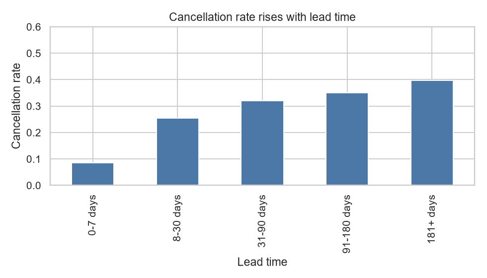
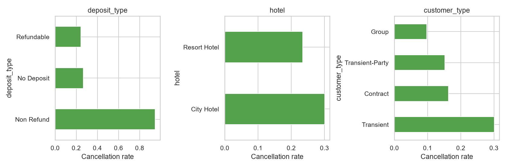
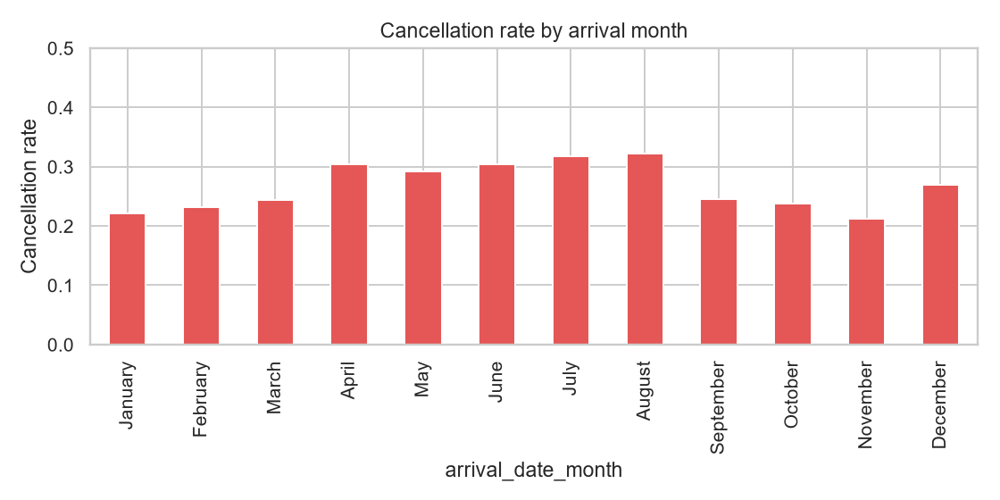

# Hotel booking cancellation prediction

A hotel can look at a reservation before arrival and ask a narrower question than "will this guest be difficult?": **how likely is this booking to be cancelled?** The score can support occupancy planning, reminder campaigns, and a cautious overbooking buffer. It is not a decision to cancel a guest's reservation for them.

This repository trains a binary classifier on the public Hotel Booking Demand dataset, keeps a later time period untouched until the final test, and serves the saved pipeline with FastAPI.

## Business problem

Empty rooms that were reserved, then cancelled, are hard to resell at the last minute. A useful model ranks bookings by cancellation risk using fields the hotel can know without waiting for the final reservation status. Staff can then:

- contact high-risk bookings earlier
- be more careful with non-refundable and long-lead reservations
- avoid treating every booking as equally likely to arrive

False alarms waste staff time and can annoy guests. Missed cancellations leave rooms empty. The threshold in this project is a starting point, not a house rule.

## Dataset

| Item | Value |
| --- | --- |
| Source article | Antonio, N., de Almeida, A., and Nunes, L. (2019). Hotel booking demand datasets. *Data in Brief*, 22, 41–49. DOI [10.1016/j.dib.2018.11.126](https://doi.org/10.1016/j.dib.2018.11.126) |
| File used | TidyTuesday redistribution, week of 11 February 2020 |
| Download | `https://raw.githubusercontent.com/rfordatascience/tidytuesday/master/data/2020/2020-02-11/hotels.csv` |
| SHA-256 | `7c2ae42a7353905ea136e5c2287f17c92c5435826598bfbb8491c6f0c7b1fc06` |
| File size | 16,855,599 bytes |
| Raw shape | 119,390 rows, 32 columns |
| Dictionary | `data/tidytuesday_readme.md` |

The article is open access. TidyTuesday cites it and publishes the CSV. Column definitions in the TidyTuesday readme are the ones used here. The two properties are a resort hotel and a city hotel in Portugal, with arrivals in 2015–2017. This is not a sample of hotels in general.

The CSV is not committed. `download_data.py` downloads it and checks the hash.

## Target

`is_canceled` is 1 when the booking was cancelled and 0 otherwise. After exact-duplicate removal and dropping 166 rows with no guests, 87,230 bookings remain and about 27.5% are cancelled. The raw file's often-quoted rate is higher because duplicate rows are counted more than once.

## Leakage prevention

These columns are not model features:

| Column | Why it is excluded |
| --- | --- |
| `reservation_status` | Text form of the outcome: Canceled, Check-Out, or No-Show |
| `reservation_status_date` | Date when that final status was set |
| `assigned_room_type` | Can be changed by the hotel at arrival |
| `booking_changes` | Accumulates until check-in or cancellation, so it depends on when you look |
| `agent`, `company` | Anonymous IDs, often missing, unlikely to transfer to another hotel |

Learned preprocessing (imputers, scalers, encoders) is fit only inside the training pipeline, on training folds or the training period. The validation period is used to pick an F1 threshold. The test period is scored once.

`required_car_parking_spaces` is kept because the published dictionary calls it a customer request. In this file, none of the bookings with a parking request are cancelled. That is a real pattern in the extract and a poor policy rule until the hotel confirms the field is stored at booking time.

The split is chronological. Booking time is estimated as arrival date minus `lead_time`, because the file has no separate creation timestamp. The earliest 60% of bookings train the model, the next 20% choose the threshold, and the latest 20% are the test set.

| Split | Rows | Booking dates | Cancellation rate |
| --- | ---: | --- | ---: |
| Train | 52,338 | 2013-06-24 to 2016-09-21 | 0.268 |
| Validation | 17,446 | 2016-09-21 to 2017-01-28 | 0.295 |
| Test | 17,446 | 2017-01-28 to 2017-08-31 | 0.277 |

Boundary dates can appear in two adjacent splits when several bookings share a day. Rows themselves are not shared.

## Exploratory findings

Executed charts are in `notebook.ipynb` and `reports/figures/`.

- Cancellation rate rises with lead time: about 0.08 within 7 days, about 0.40 beyond 180 days.
- Non-refundable deposits are uncommon after de-duplication (1,038 bookings) and cancel about 95% of the time. Ordinary no-deposit bookings cancel about 27% of the time.
- City hotel bookings cancel more often than resort bookings (about 0.30 versus 0.23).
- Transient guests cancel more often than contract, group, or transient-party bookings.
- August arrivals cancel most often among months (about 0.32); November is lower (about 0.21).
- More special requests go with a lower cancellation rate.
- `company` is missing on about 94% of raw rows. `agent` is missing on about 14%. `country` is rarely missing.







## Models and tuning

Seed is 42. Each family is a scikit-learn `Pipeline` plus `GridSearchCV` with `TimeSeriesSplit` (3 splits) on the training period. The selection score is mean ROC AUC, not training accuracy.

| Model | Search | Best mean CV ROC AUC | Best parameters |
| --- | --- | ---: | --- |
| HistGradientBoosting | `learning_rate` 0.05 or 0.1, `max_depth` 3 or 6 | 0.796 | learning rate 0.1, max depth 3 |
| Random forest | `max_depth` 8 or 16, `min_samples_leaf` 5 or 20 | 0.794 | depth 16, min leaf 5 |
| Logistic regression | `C` 0.1, 1, or 10 | 0.779 | C 0.1 |
| Decision tree | `max_depth` 4, 8, or 12 | 0.751 | depth 8 |

Histogram gradient boosting is the selected model. The validation threshold that maximizes F1 is **0.40**.

| Set | ROC AUC | Precision | Recall | F1 |
| --- | ---: | ---: | ---: | ---: |
| Train | 0.905 | 0.686 | 0.738 | 0.711 |
| Validation | 0.835 | 0.538 | 0.777 | 0.636 |
| Test | 0.826 | 0.470 | 0.862 | 0.609 |

Test confusion counts at threshold 0.40: TN 7,905, FP 4,702, FN 666, TP 4,173. The test set catches most cancellations and is wrong on a large share of the bookings it flags. That is a recall-leaning operating point. A hotel that dislikes extra guest contact should raise the threshold.

Training AUC is higher than validation and test AUC, so the fit is somewhat optimistic. Validation and test are close to each other.

On a validation sample, permutation importance is highest for market segment, parking requests, country, and lead time. Country and parking should be checked before the score is used at another property.

Full numbers: `reports/metrics.json`.

## Repository layout

```text
download_data.py          verify and download the CSV
notebook.ipynb            exploratory analysis with executed outputs
hotel_ml.py               cleaning, split, tuning, evaluation
train.py                  command-line export of that training procedure
predict.py                FastAPI service
test_client.py            calls a running service
tests/                    pytest
models/model.joblib       saved pipeline, threshold, and feature list
reports/                  metrics, charts, example request
deploy/k8s/manifest.yaml  local Kubernetes deployment and service
requirements.txt          training, notebook, and test pins
requirements-api.txt      runtime pins used by Docker
```

## Setup on Windows PowerShell

Python 3.11 is required. This project was built with Python 3.11.16 and [uv](https://docs.astral.sh/uv/).

```powershell
cd D:\Zoomcamp\hotel-booking-cancellation-prediction
uv venv .venv --python 3.11
uv pip install --python .\.venv\Scripts\python.exe -r requirements.txt
.\.venv\Scripts\python.exe download_data.py
```

If `uv` is not installed, create a Python 3.11 virtual environment with `python -m venv .venv` and install the same requirements file with that environment's pip.

## Reproduce the notebook and the training script

```powershell
.\.venv\Scripts\python.exe -m jupyter nbconvert --to notebook --execute notebook.ipynb --inplace --ExecutePreprocessor.timeout=600
.\.venv\Scripts\python.exe train.py
```

`train.py` reads `data/hotel_bookings.csv`, writes `models/model.joblib`, and overwrites `reports/metrics.json`. It accepts `--data`, `--model`, and `--reports`.

## Run the API locally

If Windows Application Control blocks a `uvicorn.exe` launcher, start the app through Python:

```powershell
.\.venv\Scripts\python.exe -m uvicorn predict:app --host 0.0.0.0 --port 9696
```

In another shell:

```powershell
.\.venv\Scripts\python.exe test_client.py http://127.0.0.1:9696
```

`GET /health` returns the model name and the threshold. `POST /predict` expects the booking fields listed in `reports/example_request.json`.

Example response from the saved example booking:

```json
{
  "cancellation_probability": 0.806479,
  "will_cancel": true
}
```

`will_cancel` is true when the probability is at least 0.40. The service loads the joblib artifact and does not retrain.

## Docker

```powershell
docker build -t hotel-cancellation-api:midterm .
docker run --rm -p 9696:9696 hotel-cancellation-api:midterm
```

The image is `python:3.11.15-slim-bookworm`. It installs `requirements-api.txt`, copies the training module, the API, and `models/model.joblib`, and listens on port 9696. Both endpoints were called against a running container. The example booking returned probability `0.806479`.

## Local Kubernetes

This was tested on a local [kind](https://kind.sigs.k8s.io/) cluster named `hotel-cancellation-midterm`. It is not a public cloud deployment. No AWS, Azure, or GCP resources were created. An existing cluster named `agent-relay` was not modified.

```powershell
kind create cluster --name hotel-cancellation-midterm
kind load docker-image hotel-cancellation-api:midterm --name hotel-cancellation-midterm
kubectl apply -f deploy/k8s/manifest.yaml --context kind-hotel-cancellation-midterm
kubectl rollout status deployment/hotel-cancellation --context kind-hotel-cancellation-midterm
kubectl port-forward service/hotel-cancellation 9696:80 --context kind-hotel-cancellation-midterm
```

The deployment became ready (`1/1 Running`). Through the port-forward, `/health` and `/predict` returned the same example probability, `0.806479`.

The cluster is still present. Delete it only if you intend to:

```powershell
kind delete cluster --name hotel-cancellation-midterm
```

## Tests

```powershell
.\.venv\Scripts\python.exe -m pytest tests -q
```

The last run reported **6 passed**. The tests check the dataset hash and schema, leakage exclusions, the time split, model reload, `/health`, `/predict`, and invalid requests.

## Limitations and responsible use

- Two Portuguese hotels in 2015–2017 do not represent every market.
- De-duplication changes the class balance. Do not compare these rates with analyses that keep duplicate rows.
- A high score is not a reason to cancel a guest's booking, deny a room, or treat nationality as a policy.
- Country and market segment can proxy for channels and local demand. Review them before acting.
- Parking requests separate cancellations perfectly in this extract. Confirm how your system stores that field.
- The 0.40 threshold favors catching cancellations over avoiding false alarms.

## Author and acknowledgements

Course project for Machine Learning Zoomcamp 2026. The dataset authors are Nuno Antonio, Ana de Almeida, and Luis Nunes. The CSV redistribution used here is TidyTuesday, maintained by the rfordatascience community. Course instruction is by Alexey Grigorev and DataTalks.Club.

The homework repository `ml-zoomcamp-2026` is a separate project and is not part of this model.
